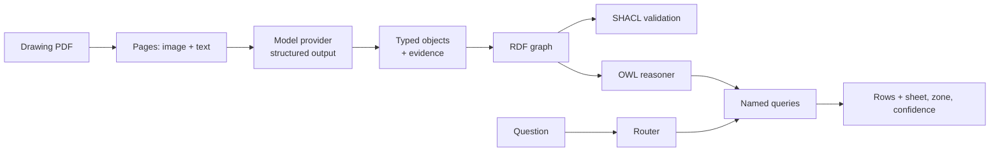
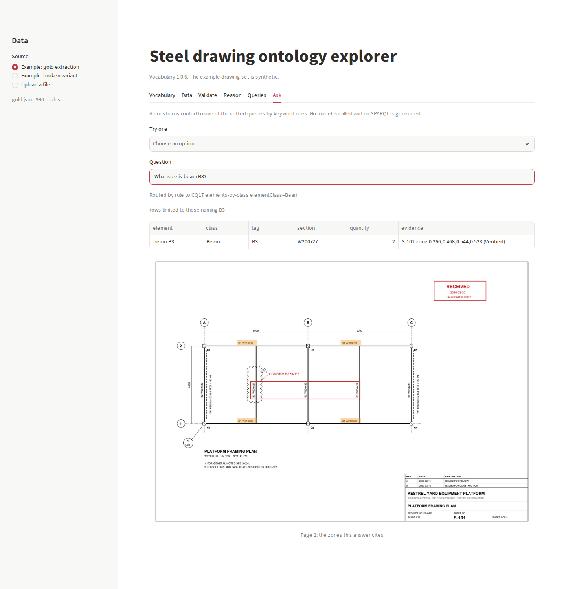

# steel-drawing-ontology

An OWL + SHACL vocabulary for structural steel fabrication drawings, with a pipeline from
drawing to typed objects to a validated, queryable knowledge graph. Every fact keeps a pointer
to the sheet and the zone it was read from.

- **Vocabulary** (`ontology/`): 108 classes (59 for extracted data, 24 closed vocabularies, 25
  reasoner-defined), 230 properties and 60 SHACL shapes (36 checks plus one per closed
  vocabulary), version 1.0.6. Developed from structural drawings
  ([how](docs/how-it-was-built.md)).
- **Pipeline** (`src/steel_ontology/`): PDF pages to typed objects through a language model
  with structured output, behind a provider abstraction (Anthropic, OpenAI, Gemini, a local
  OpenAI-compatible server, and a recorded provider that runs offline); then RDF, SHACL
  validation, OWL reasoning, 24 named competency queries (three of them ask for
  reasoner-defined classes and run the reasoner first), and plain-language questions routed to
  those queries with evidence per answer row.
- **Example** (`examples/`): a synthetic four-sheet drawing set drawn by a script, with its gold
  extraction and a deliberately broken copy.





More: [architecture](docs/architecture.md), [modelling decisions](docs/modelling-decisions.md),
[vocabulary reference](docs/vocabulary.md), [changelog](CHANGELOG.md),
[contributing](CONTRIBUTING.md).

## Quickstart (offline, about five minutes)

Needs Python 3.12 or newer and [uv](https://docs.astral.sh/uv/). No API key, and no network
after the install.

```sh
git clone https://github.com/JayMirzaei/steel-drawing-ontology
cd steel-drawing-ontology
uv sync
```

**1. Validate the example extraction.** It conforms, with no finding.

```sh
uv run steel-ontology validate examples/kestrel-platform/gold.json
```

```
conforms: 0 violation(s), 0 warning(s)
```

**2. See the broken copy fail.** It has the mistakes an extractor makes: two digits of a
schedule total swapped, a force without its factored tag, a stamp without its origin, and so
on. Exit code 1.

```sh
uv run steel-ontology validate examples/kestrel-platform/broken.json
```

```
does not conform: 5 violation(s), 1 warning(s)
VIOLATION annotation-received-stamp . annotationOrigin: Every annotation must say whether the engineer or a third party drew it.
VIOLATION default-brace-connections . defaultPercent: A default percentage must be above 0 and at most 100.
...
WARNING   schedule-columns: Printed schedule total differs from the sum of its rows by more than 0.5 percent: re-read the table before using the total.
```

**3. Run a competency query, and the reasoner.**

```sh
uv run steel-ontology query --list
uv run steel-ontology query examples/kestrel-platform/gold.json requirement-clauses -p topic=BoltingReq
uv run steel-ontology reason examples/kestrel-platform/gold.json
```

**4. Ask a question.** It is routed to a named query by keyword rules; each row cites where it
was read. A question the rules cannot place gets "I could not route this question" and the list
of questions that can be answered, not a guess.

```sh
uv run steel-ontology ask examples/kestrel-platform/gold.json "What size is beam B3?"
uv run steel-ontology ask examples/kestrel-platform/gold.json "What is the factored load on C2?"
```

```
CQ17 elements-by-class elementClass=Beam (chosen by rule): 1 row(s)
note: rows limited to those naming B3
  element=beam-B3  class=Beam  tag=B3  section=W200x27  quantity=2
      evidence: S-101 zone 0.266,0.468,0.544,0.523 (Verified)
CQ23 element-forces (chosen by rule): 1 row(s)
note: rows limited to those naming C2
  element=column-C2  tag=C2  record=force-C2-Cf  loadCase=Cf  factored=True  compression=520.0  forceUnit=kN
      evidence: S-201 zone 0.054,0.175,0.524,0.186 (Verified)
      evidence: S-201 zone 0.407,0.175,0.418,0.186 (Verified)
```

**5. Run the extraction pipeline on the PDF with recorded answers.** This renders the four
pages, replays stored model answers, decodes, merges and validates.

```sh
uv run steel-ontology extract examples/kestrel-platform/drawings.pdf \
    --provider recorded --recorded examples/kestrel-platform/recorded \
    --base-iri https://example.org/kestrel-platform/ --output out.json
```

`out.json` (ignored by git) is then byte for byte the same as `examples/kestrel-platform/gold.json`.

The recorded answers are fixture data written from the gold extraction, not the output of a
language model ([their README](examples/kestrel-platform/recorded/README.md)). They show that
the pipeline works end to end; they say nothing about how well any model reads drawings.

**6. Open the explorer** (vocabulary browser, data, validation, reasoner, queries, questions):

```sh
uv run streamlit run app/explorer.py
```

## With a real model

Install the extra for the provider and set its key (see `.env.example`):

```sh
uv sync --extra anthropic        # or: --extra openai, --extra gemini
export ANTHROPIC_API_KEY=...
uv run steel-ontology extract my-drawings.pdf --provider anthropic \
    --output extraction.json --save-responses answers/
```

`--save-responses` keeps the raw answers so the run can be replayed later with
`--provider recorded --recorded answers/`. `--provider local` talks to an OpenAI-compatible
server (llama.cpp, Ollama, vLLM) at `STEEL_ONTOLOGY_LOCAL_URL`. `steel-ontology ask` takes the
same `--provider` options for questions that no rule matches; the model may only choose one of
the named queries and its parameters.

The Anthropic provider uses `claude-opus-5-5` by default with adaptive thinking, streaming and
prompt caching of the shared system text; change the model with `--model`. The API's
server-side refusal fallback is off unless you ask for it (`--refusal-fallback` or
`STEEL_ONTOLOGY_ANTHROPIC_FALLBACKS=1`), because another model would then answer; when it is on
and fires, the result names the model that actually answered. A provider whose key is missing
stops with a one-line `error:` and exit code 2.

The variables in `.env.example` are read from the environment. Only `docker compose` reads a
`.env` file; for the command line, export them.

### Exit codes

Every `steel-ontology` subcommand uses the same three codes, so a CI job can tell bad data from
a bad file:

| Code | Meaning |
| --- | --- |
| 0 | Done, and the data passed: it conforms, is consistent, or a query answered the question |
| 1 | Done, and the data did not pass: a SHACL violation, an inconsistency, or no vetted query |
| 2 | Nothing to judge: bad arguments, a missing or unreadable file, invalid data, a provider error |

**Not verified locally:** none of the four live providers has been run against a real API or
server. No key was available while this was written. Their requests are tested against mocked
SDK clients and mocked HTTP, which pins what is sent and how failures are reported, but not that
a provider accepts it. The OpenAI and Gemini default model ids in particular should be checked
(override with `--model`).

## Docker

```sh
docker compose up                      # explorer on http://localhost:8501
docker build -t steel-ontology .
docker run --rm steel-ontology steel-ontology validate examples/kestrel-platform/gold.json
```

**Not verified locally:** Docker is not installed on the machine this was written on. The image
is built by CI (`.github/workflows/ci.yml`).

## Static demo site

`uv run steel-ontology docs --site site` builds a static site from the example: the vocabulary
reference (with an anchor per term, so the namespace IRIs can resolve to it, and a page for the
version IRI `.../core/1.0.6`), the sheets, both
validation reports, inferred classes, every competency query with its result, and a set of
questions with the cited zones drawn on the sheets. Plain HTML and CSS, no JavaScript, no
trackers. `.github/workflows/pages.yml` publishes it to GitHub Pages; it is not deployed yet.

## Layout

```
ontology/            core.ttl (OWL 2), shapes.ttl (SHACL)
src/steel_ontology/
  models.py enums.py typed objects mirroring the ontology: the extraction contract
  graph.py           typed objects <-> RDF, lossless
  validate.py        SHACL findings with severity and readable messages
  reason.py          OWL RL (pure Python) or HermiT (Java)
  queries/           24 competency questions as .rq files, and the runner
  extract/           pages, prompt, providers/, wire format, merge, pipeline
  ask.py             question -> named query -> rows with evidence
  reference.py       vocabulary reference generated from the TTL
  site.py            the static site
  cli.py             steel-ontology validate | reason | query | extract | ask | docs
app/explorer.py      Streamlit explorer
examples/            generator script, synthetic PDF, gold/broken data, recorded answers
tests/               pytest, 438 tests
docs/                architecture, modelling decisions, method, vocabulary reference, screenshots
scripts/             screenshots.py (headless browser screenshots of the explorer)
```

## Design decisions in brief

- One core ontology for all kinds of steel drawing sets; job types are values and defined
  classes, not separate vocabularies.
- OWL infers (open world), SHACL validates (closed world). Mandatory fields are shapes.
- Closed vocabularies (`oneOf` + `AllDifferent`); a value outside the list fails validation, in
  JSON (typed models) and in RDF (`sh:in` shapes).
- Text is kept as printed: dates are text, numbers keep their digits. Force and moment values
  are stored as printed with their printed unit (`forceUnit`, `momentUnit`), never converted. A
  numeric property whose name carries a unit (`elevationM`, `areaLoadKPa`) is a normalised
  value in that unit.
- Domains and ranges are as wide as the data needs: in OWL they infer, they do not check.
- Every fact can cite `Evidence` (sheet, zone, confidence).
- Third-party markup is annotation with an origin, never design content.
- Questions are answered only through vetted named queries; no model writes SPARQL.
- The model answers in a small generic wire format; the typed models check it afterwards.

Details and reasons: [docs/modelling-decisions.md](docs/modelling-decisions.md).

## Limits and what is not done

- **Extraction accuracy is unmeasured.** There is no extraction benchmark in this
  repository, and the example's recorded answers are fixtures, not model output.
- The live providers are untested against real APIs (see above).
- The example is one small, clean, vector drawing set. Scanned sheets, rotated pages, very large
  sheets and multi-discipline packages are not exercised.
- Sheets are read one at a time and merged by id only. Matching "item 3" on a plan to "C3" in a
  schedule, or two spellings of one mark, is not done.
- Grids and locations are text as printed (`gridLocationText`), not geometry.
- The keyword router knows the 24 queries and the vocabulary names. A question needs one of a
  query's own keywords; a vocabulary word alone ("column", "other") is not enough. Anything else
  gets "I could not route this question", by design. Keyword rules are brittle: unusual
  phrasings will miss, and `tests/test_ask.py` lists the phrasings that are known to work.
- OWL RL does not find every entailment; HermiT does, but needs Java (`--engine hermit`, extra
  `hermit`). Without Java its 11 tests are skipped.
- The full test suite, HermiT included, was run locally on Python 3.12, 3.13 and 3.14; CI runs
  3.12 and 3.13.
- The namespace IRIs resolve only once the Pages site is published.

## Licences of dependencies

The package and its required dependencies are under permissive licences; the optional
`hermit` extra adds owlready2, which is LGPL-3.0. PDF pages are rendered
with [pypdfium2](https://github.com/pypdfium2-team/pypdfium2) (Apache-2.0 / BSD-3-Clause, PDFium
under BSD-style terms). [PyMuPDF](https://pymupdf.readthedocs.io/), which is AGPL-3.0, is used
only in the development group: by the script that draws the synthetic example and by tests that
read the example back. It is not installed with the package and never imported by it.

## Related

[structural-drawing-reader](https://github.com/JayMirzaei/structural-drawing-reader) is
the earlier, rules-first PDF reader this work grew out of: it reads structural drawing PDFs into
a cited fact index and answers questions with the evidence highlighted on the sheet.

## Disclaimer

This is a portfolio and research project, not engineering software. It is provided "as is", without
warranty of any kind, as the MIT licence states. Its answers, extractions and validation results can be
wrong or incomplete. Do not rely on them for design, fabrication, construction, cost or safety
decisions; a qualified engineer must check anything taken from drawings or data. Whoever uses this code, or
anything built from it, is responsible for that use and its results; the author accepts no liability
for it.

## Licence

MIT. Copyright (c) 2026 Jay Mirzaei.
