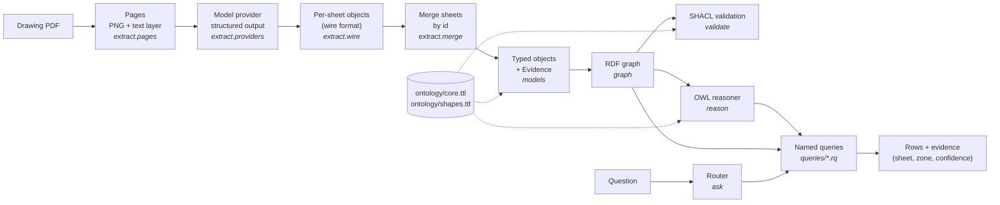

# Architecture

The repository has one idea: a steel drawing set becomes a typed, checked, queryable graph, and
every fact in it can be traced back to the place on the sheet where it was printed.

## The parts

| Module | What it does | Why it is separate |
| --- | --- | --- |
| `ontology/core.ttl` | OWL 2 vocabulary: classes, properties, closed vocabularies, defined classes | The vocabulary is the product; the code serves it |
| `ontology/shapes.ttl` | SHACL shapes: mandatory fields, ranges, table arithmetic | Validation is closed-world, the ontology is not |
| `models.py`, `enums.py` | One pydantic class per ontology class, one `StrEnum` per vocabulary | The extraction contract in Python types; tests keep it in step with the TTL |
| `graph.py` | Typed objects to RDF and back, without loss | Driven by field metadata, so there is one list of properties |
| `validate.py` | Runs pyshacl and turns the result graph into readable findings | Severity matters: only violations fail data |
| `reason.py` | OWL RL in pure Python; HermiT when Java is present | Runs anywhere by default; a complete reasoner when needed |
| `queries/` | The competency questions as `.rq` files and a runner | Questions are vetted code, never generated |
| `extract/` | PDF pages to typed objects through a model with structured output | The only part that needs a model, and it is optional |
| `ask.py` | A question to one named query, with evidence per row | Keyword rules first; a model may only choose |
| `reference.py`, `site.py` | Generated vocabulary reference and static demo site | Documentation that cannot drift from the files |
| `cli.py`, `app/explorer.py` | Command line and Streamlit explorer | Thin layers over the package |

## Extraction

`extract_pdf(pdf, provider)` reads one page at a time:

1. **Render.** `pypdfium2` renders the page to a PNG (longest side 2400 px by default) and reads
   its text layer. PDFium is permissively licensed, so the installed package carries no
   copyleft dependency. (PyMuPDF, which is AGPL, is used only by the example generator and the
   tests, in the development group.)
2. **Ask.** The provider gets a system text (reading rules plus a field catalogue generated from
   the models, in the ontology's own comments), the page image and its text layer, and a JSON
   Schema. The schema is small on purpose: a list of objects, each with `id`, `type`, a list of
   name/values pairs, a `zone` and a `confidence`. A schema of 59 classes and 200+ optional
   fields would exceed what structured-output modes accept, and they differ between providers.
3. **Decode.** `wire.decode_sheet` builds pydantic objects from the pairs. A field that does
   not exist, a value of the wrong type, a malformed zone or an unknown class is dropped and
   reported; the rest of the object is kept. Ids starting with `ev-` are refused because the
   merge step owns them.
4. **Merge.** `merge.merge_sheets` joins sightings of the same id across pages. Lists are
   united; a single value keeps the first reading and a different later reading is reported as
   a conflict, not resolved. Each sighting with a zone becomes an `Evidence` object (sheet,
   box, confidence), so a beam read on the plan and in a schedule cites both, and a mark drawn
   at three grid lines of one plan cites all three (`ev-<id>-p<page>-<n>`).
5. **Validate.** The merged extraction is validated with the shapes. The report is part of the
   result, together with every problem found on the way.

Providers implement one method, `complete(Request) -> str`:

| Provider | Back end | Needs |
| --- | --- | --- |
| `anthropic` | Claude through the `anthropic` SDK; image blocks, `output_config.format`, adaptive thinking, streaming, prompt caching; server-side refusal fallback only when asked for (`--refusal-fallback`) | extra `anthropic`, `ANTHROPIC_API_KEY` |
| `openai` | Chat Completions with image URLs and a strict `json_schema` response format | extra `openai`, `OPENAI_API_KEY` |
| `gemini` | `google-genai` with inline image parts and `response_json_schema` | extra `gemini`, `GEMINI_API_KEY` |
| `local` | Any OpenAI-compatible server (llama.cpp, Ollama, vLLM) over plain HTTP | a running server with a vision model |
| `recorded` | Replays stored answers by request key (`page-001.json`) | nothing |

`--save-responses DIR` stores the raw answers of a live run in the layout `recorded` replays, so
a paid run can be reproduced offline. The live providers are tested with mocked clients and
mocked HTTP only; see the README for what has not been verified.

## Questions

`ask(graph, question)` never writes SPARQL. The router scores each named query by weighted
keyword patterns and finds parameter values by matching vocabulary member names in the
question ("bolting" binds `topic=BoltingReq`). A query must match one of its own keywords
before parameter values count, so a lone vocabulary word ("column", "other") never chooses a
query; when no query qualifies, the answer says so and lists the questions it can answer. A vocabulary parameter that the question does
not name is run for every member, so an open question is not silently narrowed to the
query's default. A mark in the question (B3, S-101) filters the rows when a row names it.

If no rule matches and a provider is given, the model sees the list of query names and the
allowed parameter values and returns a choice in a fixed schema. The choice is checked like a
rule's: an unknown query is refused, a parameter outside the vocabulary is dropped.

Each answer row carries the evidence of every object it names: sheet number, page, zone and
confidence. The explorer and the static site draw those zones on the page image.

## Validation and inference

The two are kept apart on purpose (see [modelling decisions](modelling-decisions.md)):

- `validate` merges the ontology into the data graph (SHACL follows `rdfs:subClassOf` there, so
  a shape on `ScheduleRow` also checks every `ElementRow`) and runs pyshacl with no inference. The result depends only on stated facts.
- Queries run on the stated data plus the ontology, so `rdfs:subClassOf*` works without a
  reasoner. The three queries about reasoner-defined classes (CQ01, CQ02, CQ21) say
  `# reasoner: required` in their header; `run_query` runs OWL RL over the data first, and the
  SPARQL asks for the defined class instead of restating it.
- `infer` runs OWL RL (owlrl) by default. It entails every defined class of this ontology,
  because each is an intersection of a class with `hasValue` or `someValuesFrom` restrictions.
  HermiT (owlready2, Java) adds class-level reasoning and reasoning by cases; the tests pin one
  entailment only HermiT finds.

## Outputs

- The command line: `steel-ontology validate | reason | query | extract | ask | docs`.
- The explorer app: `app/explorer.py` (Streamlit), the same functions behind six tabs.
- The static site: `steel-ontology docs --site site` writes plain HTML from the example, with
  no JavaScript. `.github/workflows/pages.yml` publishes it.
- The vocabulary reference: `docs/vocabulary.md`, regenerated by `steel-ontology docs
  --markdown docs/vocabulary.md`; a test fails when it is stale.
